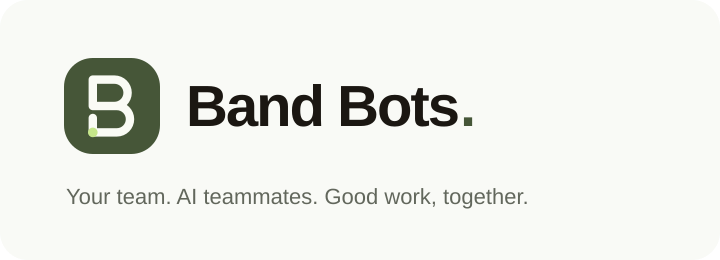
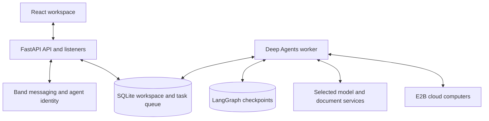

<p align="center">
  
</p>

<p align="center">A self-hosted workspace where people and persistent AI teammates get work done together.</p>

<p align="center">
  <a href="#quickstart">Quickstart</a> ·
  <a href="#what-you-can-do">Features</a> ·
  <a href="#how-it-works">Architecture</a> ·
  <a href="#documentation">Documentation</a> ·
  <a href="CONTRIBUTING.md">Contributing</a>
</p>

---

BAND_BOTS brings team conversation and agent execution into one place. Give an AI teammate a task in a channel or private chat, follow its progress, review its results, and step in when it needs you. Teammates have their own identities, roles, and channel-scoped memory, so the work can continue beyond a single prompt.

The workspace opens in light mode and remembers your theme preference. In a new conversation, starter cards help draft a first task for an available teammate; review and send it in the composer. Team activity keeps active work, requests for attention, and recent results visible alongside the conversation.

**Band** handles messaging and agent identity. **Deep Agents** run tasks using the selected OpenAI, Anthropic, Gemini, or verified compatible model connection. **E2B**, or the optional [persistent Tenki computer](docs/tenki-computers.md), gives agents private cloud computers when a task needs a browser, terminal, or running application.

## What you can do

| Capability | In your workspace |
| --- | --- |
| **Work together in context** | People and AI teammates share channels, private conversations, files, and task history. |
| **Connect with people** | Add contacts by app username, chat without agents, and invite people into channels. Human direct messages stay in the app. |
| **Build a persistent team** | Give teammates names, expressive avatars, roles, instructions, reusable skills, and scoped memory. |
| **Delegate real work** | Combine research, coding, writing, and review through specialist helpers and visible teammate hand-offs. |
| **Watch work happen** | See task ownership and progress, inspect the agent's cloud computer, and take over when needed. |
| **Use the result in chat** | Open exported webpages immediately, switch to live server apps, download files, and revisit saved views. |
| **Work with your documents** | Analyze PDFs, Word documents, spreadsheets, images, and text with source-aware document tools. |
| **Go beyond plain text** | Render charts, tables, forms, and saved interfaces. Enable custom interactive answers for agents that need them. |
| **Keep people in control** | Review approvals, cancel or resume tasks, set channel policies, inspect activity, and enforce token budgets. |

### From request to result

Create a teammate named Researcher, add it to a channel, then try:

```text
@Researcher Research this product idea, build a landing page,
and get a second opinion before sharing the result.
```

1. **Assign the work.** Your teammate receives the request with the conversation's context and can delegate to specialist helpers or visible teammates.
2. **Follow the task.** Progress, hand-offs, blockers, and approval requests stay connected to the conversation. Open the agent's computer when you need a closer look.
3. **Use the outcome.** Read the answer, inspect supporting files, or interact with the webpage preview directly in the reply.

Research and computer work require their optional services to be configured. See [configuration and capabilities](docs/reference.md#requirements-and-configuration).

## Quickstart

### 1. Prerequisites

- **Python 3.12+** and **uv**.
- **Node.js 22+** and **npm**.
- No Band key is required for signup or human chat. To create native agents from BandBot, connect your own **Band user API key** (`band_u_…`) from Band Settings → API Keys. It is verified and encrypted per user. Created agents receive their own **Agent API keys** (`band_a_…`) for runtime messaging. Existing native agents can also be imported with their agent keys.
- A model-provider account for AI execution: configure OpenAI, Anthropic, Gemini, or a verified compatible endpoint in **Providers & APIs** after signing in. Human chat works before optional provider setup.

### 2. Install and configure

From your checkout's root:

```sh
cp .env.example .env

cd backend
uv sync --locked

cd ../frontend
npm ci
cd ..
```

Edit the root `.env` file and set:

```dotenv
# Each user connects their own Band key at signup or in People, not through a shared server key.
# Optional legacy bootstrap; provider connections can be configured in the admin UI.
OPENAI_API_KEY=
APP_SECRET=replace_with_a_long_random_secret
```

Keep `APP_SECRET` stable: it protects sessions, stored credentials and provider configuration. Never commit your `.env` file. Admins configure named connections and independent service defaults in **Providers & APIs**; see [safe provider switching](docs/providers.md).

### 3. Start the workspace

Run each command block in a **separate terminal**, starting from the repository root.

**Terminal 1 — API and Band listeners**

```sh
cd backend
uv run uvicorn app.main:app --reload --port 8000
```

**Terminal 2 — agent worker**

```sh
cd backend
uv run python -m app.worker
```

**Terminal 3 — frontend**

```sh
cd frontend
npm run dev
```

Open **[localhost:5173](http://localhost:5173)** and create a local account. The Band connection is optional: add your own `band_u_…` user key at signup or under **People → Create and manage Band agents**. Configure model access in **Providers & APIs**, then choose **Add agents → Create agent**. The app registers a native agent in your Band account and securely saves its separate agent key for runtime access. Another app user supplies their own key; no shared server credential is used. Human accounts, contacts, invitations, channel membership, and human chat stay in the app database and WebSocket service.

Every account automatically receives its own private **Master** coordinator. Existing accounts get a missing Master on their next app load. Master is an app teammate, so this setup does not register a native Band identity or need a Band key. Configure a model in **Providers & APIs** for it to answer. In your private Master chat, ask it to create a persistent teammate; the new bot appears under **AI teammates** with its own instructions, memory, and private conversation. It does not join the original one-to-one chat. Connected apps start disabled for these new teammates; an administrator can grant access separately. Native Band identities remain a separate connection flow.

> The worker is required for agents to run. The API accepts messages and queues tasks; the separate worker executes them.

To serve the built UI from FastAPI instead, run `npm run build` in `frontend/` and open **[localhost:8000](http://localhost:8000)**. Keep the API and worker running.

### Connect the capabilities you need

| Optional service | Setting | Enables |
| --- | --- | --- |
| E2B | `E2B_API_KEY` | Cloud desktops, browser and terminal tools, persistent sandbox files, and live app previews. |
| Tenki (optional) | `TENKI_API_KEY`, `TENKI_DESKTOP_IMAGE` | Cloud desktops with durable data disks, pause/resume, private viewing and app previews. `TENKI_COMPUTER_SHARING=user` gives each user a private VM and a 1 GiB data disk shared by their agents, with separate agent desktops. Existing task/computer bindings are preserved. See [setup and rollback](docs/tenki-computers.md). |
| Exa | `EXA_API_KEY` | Web research and public-page retrieval. |
| Composio | `COMPOSIO_API_KEY` | Connected apps such as Gmail, GitHub, and Slack, with agent-specific access controls. |
| MCP servers | `MCP_CONFIG_PATH` | Additional tools governed by the workspace's approval policies. |

External services use your own accounts and may incur usage or storage charges. See the [full configuration reference](docs/reference.md#requirements-and-configuration) for models, timeouts, storage paths, schedules, and budgets.

### Generate images

Agents can call `generate_image` directly or delegate a requested picture to the internal
`image` helper. It calls the selected image provider and saves a real PNG in the conversation's
Files, with an inline preview, expansion and download. Photos, art and illustration
requests use this tool; SVG/code drawings are reserved for explicit vector/diagram requests.
While the image model is working, the chat shows the Assistant UI Image Generation
loading animation, then replaces it with the PNG. Failed or cancelled tasks stop the animation.
No cloud computer is required. Enable an image connection and model under
**Providers & APIs → Image generation**, independently of the agent reasoning model.
OpenAI connections also support image size, quality and transparent backgrounds.
Returned image-model token usage counts against existing
agent/channel budgets; image costs remain unknown without appropriate configured pricing.
Interrupted or uncertain paid calls are not automatically retried. This tool generates new
images; source-image editing is not yet supported. Restart the API and worker after upgrading.

## Band agent management and coming-soon human chat

**Available now:** per-user native Band agent creation and management. Band calls these account-scoped `/api/v1/me/agents` endpoints the **Human API**. They use the requesting user's encrypted `band_u_…` key and return an agent's own `band_a_…` key. Band documents account-scoped API access as an Enterprise capability; actual availability depends on the account. A rejected connection reports an error without borrowing another user's key. See [Band agent registration](https://docs.band.ai/api/human-api#agent-registration).

**Coming soon:** acting as a native Band human participant, importing that person's Band chat history, or synchronizing native human conversations. These features are separate from agent management. Human chat currently uses our own database, permissions, and WebSocket service, with no Band human-room/message polling.

Existing saved Agent API connections remain supported. They can transport app teammates with separate profiles, instructions, memory, and tasks, but cannot create additional native identities. Importing an agent key preserves its external ownership; disconnecting it does not delete the native agent. Deleting an app-managed native agent uses only its owner's saved Band user key. Shared transport identities are preserved. Existing history is retained; older native rooms without an Agent API binding are not silently assigned a different identity.

## How it works



Tasks are queued durably and execute outside the API process. Checkpoints preserve progress across worker restarts. Agent memory and computers are scoped to the agent and channel; task-scoped helpers remain distinct from visible teammates.

A dropped connection reloads the signed-in person's channels, memberships, agents, and pending invitations, then catches up messages without counting the same one twice. Sends can include a `client_id`. Retrying the same id and payload returns the original message and does not create another agent task. See [Reconnect and message retries](docs/reference.md#reconnect-and-message-retries). Sessions, recovery, people blocking, worker health, PostgreSQL, and backups are in [Operations](docs/operations.md).

Live app previews use expiring, isolated origins that proxy to a registered port on the agent's private computer. Provider credentials stay server-side. The saved **Preview** remains available when the computer is paused; **Live app** opens the running version in the same place.

**Current deployment model:** one API process and one worker share a persistent local filesystem, application database, checkpoint store, and application secret. This is one shared workspace; channel permissions are not tenant isolation. See [deployment limits](docs/reference.md#deployment-limits) before changing that topology.

## Documentation

| Guide | What you'll find |
| --- | --- |
| [Configuration and operations](docs/reference.md) | Environment variables, document processing, memory, recovery, computers, approvals, schedules, integrations, and deployment. |
| [Operations](docs/operations.md) | Sessions, recovery email, blocking, worker health, Alembic, PostgreSQL, and backup restore. |
| [Architecture](docs/architecture.md) | Source map, feature boundaries, and where changes belong. |
| [Interactive answers](docs/interactive-ui.md) | Opt-in custom interfaces, sandbox restrictions, and human-reviewed follow-ups. |
| [Assistant UI Elements](docs/assistant-ui-elements.md) | Installed components, supported compositions, and integration boundaries. |
| [Contributing](CONTRIBUTING.md) | Local development, coding conventions, verification, and pull requests. |
| [Repository guidelines](AGENTS.md) | Product intent, application invariants, and security expectations. |

## Development

### Add connected agent teammates

Open **Add agents** and choose **Create agent**, **Codex**, **Claude Agent**, **Cursor**, or **OpenClaw**. Create agent opens the custom teammate editor and uses your saved Band connection. External providers open a dedicated connection screen, authenticate first, and select a model and display name automatically; these can be changed under Connection options. Optionally add the teammate to the current channel. Existing accounts without a saved platform connection can still choose **Connect Band agent** with that identity's `band_a_…` key, or add a platform connection in People. Credentials are encrypted using `APP_SECRET` and never returned to the browser. Provider connections belong to the person who authenticated them; signed-in users can connect their own providers. See [people and Band accounts](docs/people-and-band-accounts.md) for contact requests and channel invitations. Remove agents using a provider connection before disconnecting it. See [connected agent setup](docs/connected-agents.md) for provider requirements and connection steps.

Run `uv sync --locked` in `backend/` for the Claude and Cursor Agent SDKs. Install the Codex CLI on the API/worker host with `npm install -g @openai/codex`; use `CODEX_EXECUTABLE` for a custom native executable. The API and worker must have the same runtime installation. OpenClaw uses an approved Gateway and a dedicated agent whose native tools are disabled. No runtime needs a user terminal to remain open.

On a local installation, **Codex → Sign in with ChatGPT** uses the installed Codex app-server's browser login. The app starts a separate credential session, opens OpenAI authorization, and saves the completed session encrypted; the worker lets Codex refresh its tokens. Codex's callback listener uses port 1455, which must be free, and the browser must run on the API host. This option is offered on `localhost` or `127.0.0.1` without an environment flag. The app never imports the host's existing Codex login. Claude uses Anthropic API keys; claude.ai subscription login is not offered.

The separate, optional Sign in with ChatGPT client integration remains gated by `CODEX_CHATGPT_SIGN_IN=on`, with `AGENT_OAUTH_REDIRECT_URI=http://127.0.0.1:8000/auth/callback`. It uses PKCE, single-use state and verified ID tokens. This is distinct from Codex's native port-1455 login. Hosted or paid products must obtain the appropriate provider access before offering subscription usage; these local login routes reject remote hostnames.

Connected agents run in the existing worker. Codex app-server, Claude Agent SDK, Cursor Agent SDK, and the OpenClaw Gateway supply reasoning steps using structured responses; Deep Agents owns checkpointed conversation state and executes the selected app tools. Native vendor shell/file tools, personal CLI configuration, plugins and MCP servers are disabled. Local children receive only their own connection credential in a clean temporary home; OpenClaw's dedicated native tool policy is checked before every step. Code execution, files and computer actions use the selected E2B or Tenki computer. Tenki workspace sharing keeps private-chat computers separate. App tools retain approvals, cancellation, memory isolation, connected-app restrictions and token budgets. Hosted OpenAI Code Interpreter is not attached to connected runtimes. Vendor output arrives at model-step boundaries rather than as live token deltas.

This is an embedded runtime integration, not a mirror of the user's Codex or Claude desktop chats. Conversation recovery comes from LangGraph checkpoints, not vendor session files. Codex app-server is an evolving interface; the optional offline CLI contract test checks its output and ensures native execution tools stay disabled. Provider sign-in and live model execution require a real account and have not been exercised by the offline suite.

Provider references: [Codex app-server](https://learn.chatgpt.com/docs/app-server), [Sign in with ChatGPT](https://developers.openai.com/siwc/token-sharing-open-source), and [Claude Agent SDK](https://code.claude.com/docs/en/agent-sdk/overview).

Run the offline checks from the repository root:

```sh
cd backend
uv run pytest -q

cd ../frontend
npm test
npm run build
```

Backend tests use temporary databases and fake providers. The frontend build checks the UI catalogue, TypeScript, bundle budgets, and the compiled diagram worker. UI changes also need browser checks of the affected interactions at desktop and phone widths.

Contributions that make agent work clearer, more reliable, or easier to review are welcome. Start with [CONTRIBUTING.md](CONTRIBUTING.md), keep pull requests focused, and include verification results and screenshots for visual changes.

## License and acknowledgments

A project-wide license has not yet been selected. Third-party code retains its own notices, including the [Assistant UI component license](frontend/src/components/assistant-ui/LICENSE) and [adapted workflow provenance](backend/app/runtime/builtin_skills/PROVENANCE.md).

Built with Band, OpenAI, Deep Agents, LangGraph, E2B, FastAPI, React, assistant-ui, Tailwind CSS, and shadcn/ui.

Provider selection and safe switching: see [Providers & APIs](docs/providers.md). Existing environment settings are imported once; defaults stay unchanged until explicit admin activation. Human chat does not require an OpenAI key.
