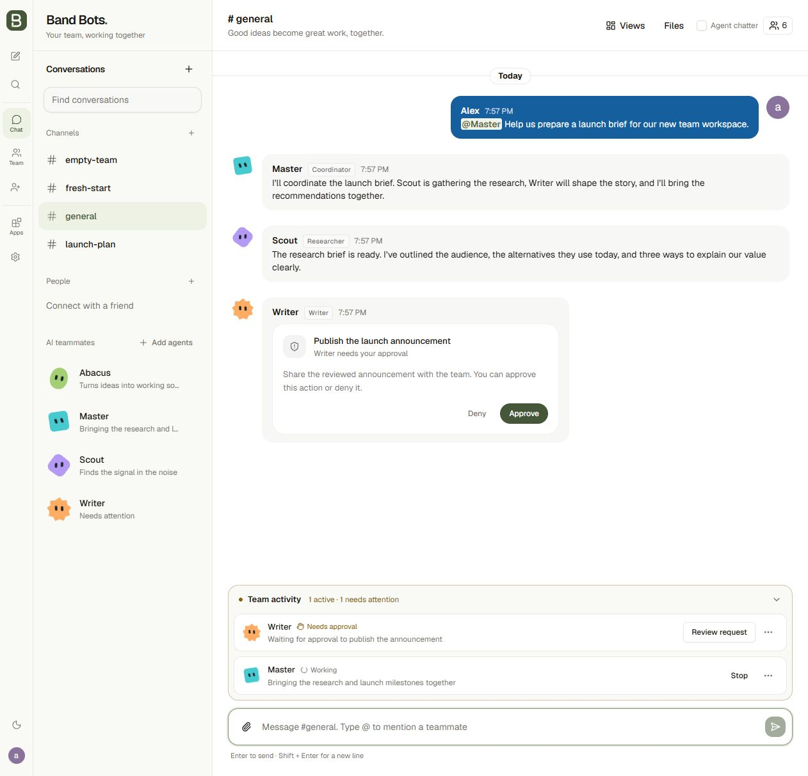
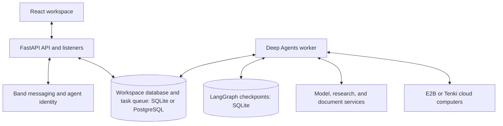

<p align="center">
  
</p>

<p align="center">A self-hosted workspace where people and persistent AI teammates get work done together.</p>

<p align="center">
  <a href="#quickstart">Quickstart</a> ·
  <a href="#what-you-can-do">Features</a> ·
  <a href="#how-it-works">Architecture</a> ·
  <a href="#documentation">Documentation</a> ·
  <a href="CONTRIBUTING.md">Contributing</a>
</p>

---

BAND_BOTS brings team conversation and agent execution into one place. Give an AI teammate a task in a channel or private chat, follow its progress, review its results, and step in when it needs you. Teammates have their own identities, roles, and channel-scoped memory, so the work can continue beyond a single prompt.

<p align="center">
  
  <br />
  <sub>Workspace preview with sample data.</sub>
</p>

**Band** handles messaging and agent identity. **Deep Agents** run tasks using the selected OpenAI, Anthropic, Gemini, or verified compatible model connection. **E2B**, or the optional [persistent Tenki computer](docs/tenki-computers.md), gives agents private cloud computers when a task needs a browser, terminal, or running application.

## What you can do

| Capability | In your workspace |
| --- | --- |
| **Work together in context** | People and AI teammates share channels, private conversations, files, and task history. |
| **Connect with people** | Add contacts by app username, chat without agents, and invite people into channels. Human direct messages stay in the app. |
| **Build a persistent team** | Give teammates names, expressive avatars, roles, instructions, reusable skills, and scoped memory. |
| **Delegate real work** | Combine research, coding, writing, and review through specialist helpers and visible teammate hand-offs. |
| **Watch work happen** | See task ownership and progress, inspect the agent's cloud computer, and take over when needed. |
| **Use the result in chat** | Open exported webpages immediately, switch to live server apps, download files, generate images, and revisit saved views. |
| **Work with your documents** | Analyze PDFs, Word documents, spreadsheets, images, and text with source-aware document tools. |
| **Go beyond plain text** | Render charts, tables, forms, and saved interfaces. Enable custom interactive answers for agents that need them. |
| **Keep people in control** | Review approvals, cancel or resume tasks, set channel policies, inspect activity, and enforce token budgets. |

The workspace opens in light mode and remembers your theme preference. In a new conversation, starter cards help draft a first task for an available teammate; review and send it in the composer. Team activity keeps active work, requests for attention, and recent results visible alongside the conversation.

### From request to result

Create a teammate named Researcher, add it to a channel, then try:

```text
@Researcher Research this product idea, build a landing page,
and get a second opinion before sharing the result.
```

1. **Assign the work.** Your teammate receives the request with the conversation's context and can delegate to specialist helpers or visible teammates.
2. **Follow the task.** Progress, hand-offs, blockers, and approval requests stay connected to the conversation. Open the agent's computer when you need a closer look.
3. **Use the outcome.** Read the answer, inspect supporting files, or interact with the webpage preview directly in the reply.

Research and computer work require their optional services to be configured. See [configuration and capabilities](docs/reference.md#requirements-and-configuration).

## Quickstart

### 1. Prerequisites

- **Python 3.12+** and **[uv](https://docs.astral.sh/uv/)**.
- **Node.js 22.12+** and **npm**.
- A model-provider account for AI execution: configure OpenAI, Anthropic, Gemini, or a verified compatible endpoint in **Providers & APIs** after signing in. Human chat works before optional provider setup.
- Optional: your own **Band user API key** (`band_u_…`, from Band Settings → API Keys) to create native Band agents. No Band key is needed for signup or human chat. See [people and Band accounts](docs/people-and-band-accounts.md).

### 2. Install and configure

From your checkout's root:

```sh
cp .env.example .env

cd backend
uv sync --locked

cd ../frontend
npm ci
cd ..
```

Edit the root `.env` file and set at least:

```dotenv
APP_SECRET=replace_with_a_long_random_secret
# Optional: imported once as an OpenAI connection; manage providers in the admin UI afterwards.
OPENAI_API_KEY=
```

Keep `APP_SECRET` stable: it protects sessions, stored credentials and provider configuration. Never commit your `.env` file. Admins configure named connections and independent service defaults in **Providers & APIs**; see [safe provider switching](docs/providers.md).

### 3. Start the workspace

Run each command block in a **separate terminal**, starting from the repository root.

**Terminal 1 — API and Band listeners**

```sh
cd backend
uv run uvicorn app.main:app --reload --port 8000
```

**Terminal 2 — agent worker**

```sh
cd backend
uv run python -m app.worker
```

**Terminal 3 — frontend**

```sh
cd frontend
npm run dev
```

Open **[localhost:5173](http://localhost:5173)** and create a local account. Configure model access in **Providers & APIs**, then choose **Add agents → Create agent**.

Every account automatically receives its own private **Master** coordinator; existing accounts get one on their next app load. Master is an app teammate, so it registers no native Band identity and needs no Band key, only a configured model. In your private Master chat, ask it to create a persistent teammate; the new bot appears under **AI teammates** with its own instructions, memory, and private conversation. Connected apps start disabled for new teammates; an administrator can grant access separately.

> The worker is required for agents to run. The API accepts messages and queues tasks; the separate worker executes them.

To serve the built UI from FastAPI instead, run `npm run build` in `frontend/` and open **[localhost:8000](http://localhost:8000)**. Keep the API and worker running.

### Connect the capabilities you need

| Optional service | Setting | Enables |
| --- | --- | --- |
| E2B | `E2B_API_KEY` | Cloud desktops, browser and terminal tools, persistent sandbox files, and live app previews. |
| Tenki | `TENKI_API_KEY`, `TENKI_DESKTOP_IMAGE` | Cloud desktops with durable data disks, pause/resume, private viewing and app previews. `TENKI_COMPUTER_SHARING=user` gives each user a private VM shared by their agents, with separate agent desktops. See [setup and rollback](docs/tenki-computers.md). |
| Exa | `EXA_API_KEY` | Web research and public-page retrieval. |
| Composio | `COMPOSIO_API_KEY` | Connected apps such as Gmail, GitHub, and Slack, with agent-specific access controls. |
| MCP servers | `MCP_CONFIG_PATH` | Additional tools governed by the workspace's approval policies. |
| Connected runtimes | per user, in the app | Codex, Claude Agent, Cursor, and OpenClaw teammates. See [connected agents](docs/connected-agents.md). |

Environment keys only bootstrap a new installation; afterwards services are activated in **Providers & APIs**. External services use your own accounts and may incur usage or storage charges. See the [full configuration reference](docs/reference.md#requirements-and-configuration) for models, timeouts, storage paths, schedules, and budgets.

## Band agents and human chat

**Available now:** per-user native Band agent creation and management. Each user's encrypted `band_u_…` key registers agents through Band's account-scoped agent endpoints (which Band calls the [Human API](https://docs.band.ai/api/human-api#agent-registration)); each agent then runs with its own `band_a_…` key. Band documents account-scoped API access as an Enterprise capability, so availability depends on the account; a rejected key reports an error and never borrows another user's key or a server-wide key. Existing native agents can be imported with their agent keys, and saved Agent API connections remain supported.

**Coming soon:** acting as a native Band human participant and synchronizing native human conversations. Human accounts, contacts, invitations, channel membership, and human chat currently use this app's own database and WebSocket service.

Details: [people and Band accounts](docs/people-and-band-accounts.md).

## How it works



Tasks are queued durably and execute outside the API process. Checkpoints preserve progress across worker restarts. Agent memory and computers are scoped to the agent and channel; task-scoped helpers remain distinct from visible teammates.

A dropped connection reloads the signed-in person's channels, memberships, agents, and pending invitations, then catches up messages without counting the same one twice. See [reconnect and message retries](docs/reference.md#reconnect-and-message-retries). Sessions, recovery, people blocking, worker health, PostgreSQL, and backups are in [Operations](docs/operations.md).

**Current deployment model:** one API process and one worker share a persistent local filesystem, application database, checkpoint store, and application secret. This is one shared workspace; channel permissions are not tenant isolation. See [deployment limits](docs/reference.md#deployment-limits) before changing that topology.

## Deploy

The [`Dockerfile`](Dockerfile) builds one image that runs the API and the worker together ([`deploy/start.sh`](deploy/start.sh)), so both share the same database files. Blueprints are included for [Render](render.yaml) and [DigitalOcean App Platform](deploy/digitalocean-app.yaml); read the comments at the top of each about persistent storage before relying on them.

- Set `BAND_ENV=production` and an `APP_SECRET` of at least 32 random characters.
- Keep `DATABASE_URL`, `AGENT_CHECKPOINT_PATH`, and `DOCUMENTS_PATH` on persistent storage. `AGENT_CHECKPOINT_PATH` is always a local SQLite file.
- The image does not include the Codex CLI. Install it in a derived image if you want Codex teammates.
- Live app previews in production need a dedicated wildcard domain; see `APP_PREVIEW_BASE_URL` in [the reference](docs/reference.md).

## Documentation

| Guide | What you'll find |
| --- | --- |
| [Configuration and operations](docs/reference.md) | Environment variables, document processing, images, memory, recovery, computers, approvals, schedules, integrations, and deployment limits. |
| [Operations](docs/operations.md) | Sessions, recovery email, blocking, worker health, Alembic, PostgreSQL, and backup restore. |
| [Providers & APIs](docs/providers.md) | Model and service connections, verification, safe switching, and recovery. |
| [People and Band accounts](docs/people-and-band-accounts.md) | Contacts, invitations, shared channels, and per-user Band agent ownership. |
| [Connected agents](docs/connected-agents.md) | Codex, Claude Agent, Cursor, and OpenClaw setup and execution model. |
| [Tenki computers](docs/tenki-computers.md) | Persistent desktops, sharing modes, images, retention, and rollback. |
| [Per-user computers design](docs/per-user-computers-design.md) | How private Tenki computers are isolated and verified. |
| [Interactive answers](docs/interactive-ui.md) | Opt-in custom interfaces, sandbox restrictions, and human-reviewed follow-ups. |
| [Assistant UI Elements](docs/assistant-ui-elements.md) | Installed components, supported compositions, and integration boundaries. |
| [Architecture](docs/architecture.md) | Source map, feature boundaries, and where changes belong. |
| [Branding](docs/branding.md) | Name, mark, colours, and design previews. |
| [Contributing](CONTRIBUTING.md) | Local development, coding conventions, verification, and pull requests. |
| [Repository guidelines](AGENTS.md) | Product intent, application invariants, and security expectations. |
| [Security policy](SECURITY.md) | How to report a vulnerability. |

## Development

Run the offline checks from the repository root:

```sh
cd backend
uv run ruff check
uv run pytest -q

cd ../frontend
npm test
npm run build
```

Backend tests use temporary databases and fake providers. The frontend build checks the UI catalogue, TypeScript, bundle budgets, and the compiled diagram worker. UI changes also need browser checks of the affected interactions at desktop and phone widths; `npm run e2e` runs the two-user Playwright suite.

Contributions that make agent work clearer, more reliable, or easier to review are welcome. Start with [CONTRIBUTING.md](CONTRIBUTING.md), keep pull requests focused, and include verification results and screenshots for visual changes.

## License and acknowledgments

BAND_BOTS is released under the [MIT License](LICENSE).

Third-party code keeps its own license:

- [assistant-ui components](frontend/src/components/assistant-ui/LICENSE) (MIT)
- [Lobe Icons artwork](frontend/src/components/icons/LICENSE.lobe-icons) (MIT)
- [Adapted built-in agent skills](backend/app/runtime/builtin_skills/LICENSE) (MIT; see [provenance](backend/app/runtime/builtin_skills/PROVENANCE.md))

Built with Band, Deep Agents, LangGraph, E2B, FastAPI, React, assistant-ui, Tailwind CSS, and shadcn/ui.
