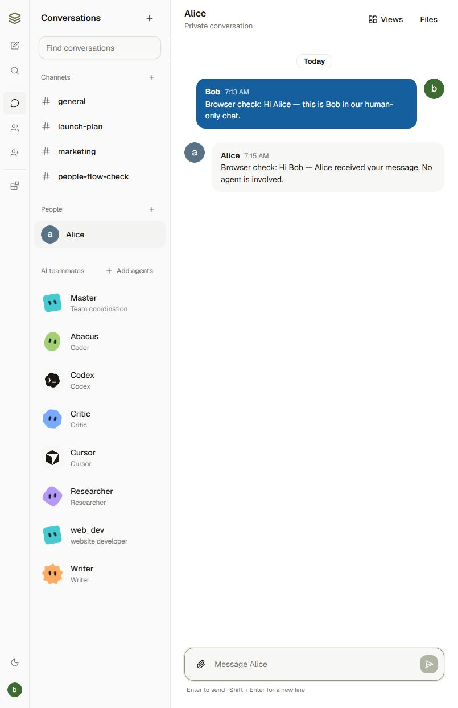
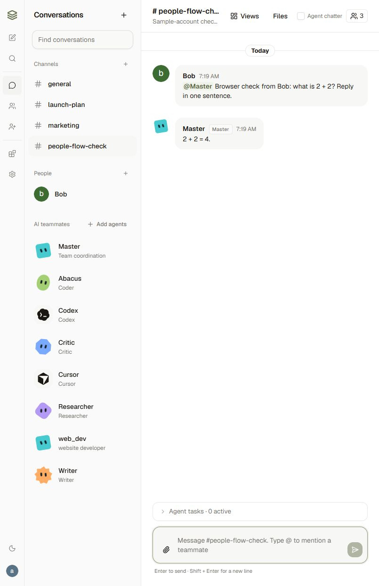

# People, contacts, and shared channels

People use ordinary app accounts. They do not need a Band account or individual Band API key to add contacts, chat, create channels, or accept channel invitations.

Open **People** using the person-plus navigation button or the user menu.

1. Find someone by their app username, or choose **Add** in the workspace directory.
2. The recipient opens **People** and accepts the contact request. Pending requests grant no conversation access.
3. Choose **Message** to open a private conversation containing only the two people. Human direct messages stay in the app database and WebSocket service; they are not sent to Band or any AI agent. Typing an agent name in these conversations does not create agent work.
4. Create a channel, open its member panel, and choose **Invite people**. Invitations require an accepted app contact. The recipient accepts in **People** before they can read history or send messages. Members can leave; the channel owner remains responsible for the channel.
5. Add AI teammates when needed. Invited humans can address those agents in the shared channel, but cannot privately DM, manage, or reshare someone else's owned agent.

Contacts, requests, memberships and messages use the application database (SQLite by default, or PostgreSQL when `DATABASE_URL` points there). The server enforces access for bootstrap, history, tasks, documents, usage, and WebSocket events. New channels use explicit membership and start without agents. Existing shared-workspace channels retain their original access.

While People is closed, a contact request or channel invitation raises the People badge and a row in the conversation list. Those updates arrive on the WebSocket for the two people involved and are loaded again after a reconnect. A third person does not receive the event.

The sender can **Cancel** a contact request that is still pending. The channel owner can **Withdraw** a pending invitation. Accepting after either of those does nothing: no contact and no membership is created. Deciding the same request again is safe.

**Remove** deletes the contact. Shared channels, memberships, and history remain. Opening a new direct message requires a new accepted request.

**Block** stops new contact requests, new direct messages, and new invitations in both directions. It does not remove someone from a channel they already share, and it does not delete history. An existing direct message stays visible with its history, and its composer explains that messaging is unavailable. A shared channel continues to accept messages. **Unblock** removes only your block.

The sample Alice and Bob accounts exchanging private messages:

After Alice invites Bob into a channel with Master, Bob can address the agent there without a personal Band connection:

## Band and agent ownership

The operator's workspace Band connection supplies agent identities and agent transport by default. This is one server-side integration; each person does not need another key. Human collaboration continues when Band is offline. A channel without a Band room can acquire one when an agent is explicitly added and a connection is available.

Channel messages mirrored to Band use the room's owning connection with the app author's display name. Agent routing and model execution remain in the separate worker. Human app members do not automatically become native Band participants. App friendship and native Band contact consent are separate relationships.

The **Personal Band account (optional)** section lets someone connect their own Band human API key if they want newly created agents and agent channels owned by that account on Band's platform. Existing rooms and agents keep their original connection. A Band identity can be linked to one app user, and key updates must retain that identity. Keys are encrypted with `APP_SECRET` and never returned to the browser. Appropriate Human API access is required only for that optional connection or the operator's Band integration.

Band's own contacts can be managed independently in Band. Bringing agents owned by different native Band accounts into a Band room also follows Band's own contact and participant permissions.

Codex, Claude, Cursor, and OpenClaw authentication is separate again: users connect their own provider credentials to run those agents. Provider connections belong to their creator. A personal Band key is not required to use a provider through the workspace Band integration. Custom agents use the server's configured OpenAI models. Workspace app access and skills remain governed by admin policies.

Runtime installation, model billing, MCP services, E2B and workspace roles remain operator-managed. This is a shared installation, not separate hosted execution environments or tenant isolation. Run one API process and one worker with the same database, checkpoints, environment, and stable `APP_SECRET`. Unconfirmed Band sends are not blindly retried.
