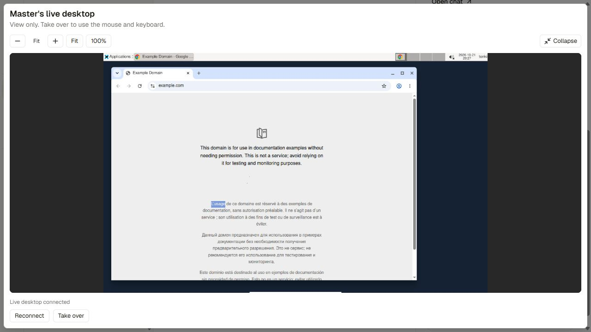

# Persistent Tenki computers

Tenki provides XFCE desktops, Chrome, terminal tools, persistent files, live viewing,
human take-over and private server-app previews. The default `user` sharing mode gives
each app user a separate VM and durable filesystem. Their agents share project files,
installed tools and common home credentials, while each agent gets its own X display,
mouse/keyboard state, browser profile, screenshots and viewer ports. Browser cookies
and sign-ins are per profile; they are not automatically synchronized.

Memory and private chat remain scoped to agent and channel. Other users and their
agents cannot browse, view, control or mount this computer, even in a shared channel.
Computer work requires a task originating from the owner; hand-offs and schedules
retain that original authority. Only the computer owner can answer input requests or
decide approvals for its tasks; channel approval policies still apply. Group file
exports require approval from the computer owner and publish bounded copies.
Interactive app previews stay in private chats.
Private computer details and controls are hidden from group-channel computer listings.
Owners can inspect their agents from their private profiles.

`workspace` and `agent_channel` remain legacy opt-in modes. Historical tasks retain
their pinned provider revision and computer, even when the selected mode changes.
Existing disks are never resized, migrated, or deleted automatically.

A cross-process host lock serializes VM lifecycle and computer operations. Independent
displays keep input and screenshot observations separate. Take-over pauses input only
on the selected desktop. A task finishing must not pause a sibling task or active viewer.

The computer starts on first use, resumes when a tool or viewer needs it, and
pauses after task completion unless someone is viewing it. API/worker crashes
have a provider runtime deadline as a fallback. Pausing stops compute; retained
VM state, images and data disks can still incur storage charges.

In **Live desktop**, use **Expand** to open the computer across the app window.
Use **+ / −** to zoom, **Fit** to see the whole desktop, or **100%** for its original
size; scrollbars expose the rest of a zoomed desktop. **Take over**, **Hand back**
and **Reconnect** remain available in the expanded view. Expanding and zooming
preserve the live connection and do not change the remote display or permissions.



## Durable state

Each Tenki scope has a named persistent volume mounted at
`/home/tenki/workspace`. Commands start there and uploads land in its `uploads/`.
Home folders such as Desktop, Documents and Downloads use the disk, as do
`.config`, `.cache`, `.local` and Chrome's profile. Existing home entries migrate
on attach; new loose home entries are collected again before the app pauses.
Recovery keeps saved settings over replacement-image defaults and preserves
conflicting incoming files under `.band-home-conflicts/` on the disk.
A normal pause preserves running processes and browser state. If the VM
expires, a new VM attaches the same disk; processes must restart, packages outside
the disk may need reinstalling, and websites may require another sign-in.
The app does not silently substitute an empty disk if its saved disk is missing.
The profile's viewer follows the computer identity across task changes, keeping
its live connection, selected tab and file location when another run starts.

Default resources are 2 vCPU, 4 GiB RAM, 20 GiB root disk and a 1 GiB data volume.
`TENKI_DISK_GIB` selects 1–50 GiB for new data volumes. It does not resize existing
volumes. There is no claim of a 120 GiB included disk. Paused VM retention defaults
to 7 days; the data volume survives VM termination until explicitly deleted.
Do not put durable data in `/tmp`, which Tenki clears when pausing.

## Setup and selection

Keep E2B configured during validation. API and worker must use the same root `.env`,
database, checkpoint path and stable `APP_SECRET`. The application never reads keys
from local trial folders. Configure the root environment:

```dotenv
COMPUTER_PROVIDER=e2b
TENKI_API_KEY=your_workspace_key
TENKI_DESKTOP_IMAGE=snapshot:your_clean_snapshot_id
TENKI_COMPUTER_SHARING=user
TENKI_DISK_GIB=1
TENKI_TIMEOUT_SECONDS=1200
TENKI_PAUSE_RETENTION_SECONDS=604800
TENKI_LIFECYCLE_TIMEOUT_SECONDS=180
```

Build an image once, separately from agent tasks, from `backend/`:

```powershell
uv sync --locked
uv run python -m app.computer.build_tenki_image --state-file ../.tmp-tenki-image/build.json
```

Use a new state file for an intentional new build. This allocates a temporary
builder and retains a clean durable image, then terminates the builder. A failed
or uncertain build must be inspected using its state file before another build.
Never bake provider keys, workspace credentials or a signed-in browser into it.

Drain queued/running/waiting tasks, stop the API and worker, then select Tenki:

```powershell
uv run python -m app.computer.select --provider tenki --agent 1 --channel 1
# Or, after the canary is accepted, all existing scopes:
uv run python -m app.computer.select --provider tenki --all-scopes
```

Restart one API and one worker. New tasks are bound atomically to their selected
provider. Startup applies Alembic revision `0003_computer_providers` on both
SQLite and PostgreSQL, preserving saved VMs and historical task bindings. Existing tasks, checkpoints and app previews retain their original
provider and computer. New scopes use `COMPUTER_PROVIDER`; set that to `tenki` only
after validation. The agent profile shows the currently selected provider; older
computer results remain accessible from their historical task messages.

Sharing mode also applies only to new tasks. Stop idle services before changing
it, and prepare a new maintenance task for each participating agent/channel so
the shared computer appears in their profiles immediately. Existing isolated
computers and disks are retained; their files are never silently merged. Removing
one teammate does not retire the workspace-owned computer or disk.

An operator can prepare a selected computer immediately, without a model turn or
chat send, using `uv run python -m app.computer.prepare --agent 1 --channel 1`.
It records a completed maintenance task, captures the desktop and leaves it paused.

If there are waiting approvals, `--preserve-waiting` permits a future-task
selection only after verifying those waiting tasks already have pinned computer
bindings. Their provider, checkpoint and approvals stay unchanged. Queued and
running work still blocks selection; never cancel an approval just to migrate.

For rollback, drain work, stop services, select `--provider e2b` using the same
scope flags, set the default back to E2B, and restart. No E2B disk or credential
is removed by enabling Tenki. Data is not automatically copied between providers.

## Private access and recovery

The application exposes only nginx's guarded port 6099. It requires a random
per-VM ingress secret and a server-registered port. Both secrets and provider
endpoint URLs stay encrypted server-side. No raw VNC, CDP or provider preview URL
is sent to the browser. Read-only watching is enforced by a separate VNC server.
Channel membership, private-chat ownership, computer policy and take-over controls
remain enforced by the app and periodically rechecked on streams.

An SDK client detach never terminates the VM. Pause must be confirmed durable;
pending pauses stay visible as `pausing`. A missed create response is recovered by
owned metadata/name; an uncertain allocation blocks duplicates. Volumes are never
replaced automatically after an uncertain create or an ownership mismatch.

Deleting an agent revokes endpoints and retires its computer/disk records. It
does not delete cloud data. Inspect and explicitly remove retired VMs, volumes
and unused images in Tenki when the data is no longer needed.

## Verification

Ordinary tests clear Tenki credentials and use fake SDK objects:

```powershell
uv run pytest
```

Live acceptance must cover fresh internet access, full desktop and browser input,
files, anonymous ingress rejection, VNC read-only enforcement, take-over/hand-back,
private app HTTP/WebSockets, durable pause/resume, VM replacement with the same
data disk, credential expiry, crash deadline and worker restart. Never report a
fresh computer's empty disk as restored data.
